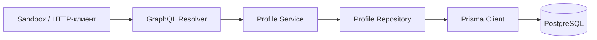

# Developer Profile API

Цифровая визитка Дмитрия Ерохина: профиль, профессиональные ссылки, навыки, опыт и проекты.
Backend на TypeScript, Node.js, NestJS, GraphQL и Prisma с PostgreSQL. Запросы можно выполнять через Apollo Sandbox.

## Запуск одной командой

Нужен работающий Docker с Docker Compose. Node.js на компьютере и файл `.env` для этого запуска не нужны.
Склонируйте репозиторий и запустите приложение:

```bash
git clone https://github.com/DmitryErokhin-Git/developer-profile-api.git
cd developer-profile-api
docker compose up --build
```

После запуска откройте **<http://localhost:3000/graphql>**. В Sandbox уже подготовлен запрос — нажмите ▶ для выполнения.
Проверка работоспособности: <http://localhost:3000/health>.

Compose последовательно запускает:

1. `db` — PostgreSQL и проверку готовности.
2. `init` — сохранённые миграции, затем первоначальное заполнение.
3. `api` — только после успешного завершения `init`.

Статус `init: Exited (0)` означает успешную подготовку. При ошибке миграций или наполнения API не запускается.

В другом терминале, из каталога проекта:

```bash
docker compose ps -a
docker compose logs init api
docker compose down
```

`down` останавливает проект, сохраняя базу в томе. **`docker compose down --volumes` удаляет данные**: следующий запуск создаст базу заново.
Первый запуск скачивает зависимости и образы; для сборки нужно несколько гигабайт свободного места.

## Как пользоваться GraphQL и Sandbox

GraphQL — язык запросов к API. Клиент перечисляет нужные поля, а сервер возвращает JSON той же структуры.
Схема описывает доступные поля и их типы; Sandbox получает её через introspection и предлагает автодополнение.

Sandbox — готовый браузерный клиент Apollo. Backend отдаёт страницу с его встраиванием, затем интерфейс
отправляет запросы на `/graphql`. Отдельный контейнер, собственный frontend и аккаунт Apollo не нужны.
Для загрузки интерфейса нужен доступ к CDN Apollo. Сам GraphQL API от этого CDN не зависит.

Запрос со всеми публичными полями; ненужные поля можно убрать:

```graphql
query DeveloperProfile {
  profile {
    id
    name
    description
    links {
      id
      label
      url
    }
    skills {
      id
      name
    }
    experience {
      id
      company
      position
      startDate
      endDate
      achievements
    }
    projects {
      id
      name
      url
    }
  }
}
```

Без браузера:

```bash
curl http://localhost:3000/graphql \
  -H 'Content-Type: application/json' \
  --data '{"query":"{ profile { name skills { name } } }"}'
```

Контракт:

- `profile` возвращает владельца визитки или `null`, если его запись отсутствует.
- Связанные списки всегда являются массивами, без `null` внутри; пустые данные — `[]`.
- Периоды работы представлены строками `YYYY-MM`, текущая работа имеет `endDate: null`.
- В API нет mutations: публичный доступ предоставляет только чтение.
- Ошибка БД возвращает безопасное сообщение GraphQL без SQL, URL подключения и stack trace.
  Проверяйте поле `errors` ответа: HTTP 200 сам по себе не означает успешное выполнение GraphQL-запроса.

## Данные и их обновление

Публичные данные находятся в [`data/profile.json`](data/profile.json).
Приложение читает данные из PostgreSQL. JSON используется только командами заполнения и импорта.

Файл содержит `name`, `description` и четыре массива: `links`, `skills`, `experience`, `projects`.
Все эти поля обязательны, массивы могут быть пустыми; неизвестные поля отклоняются.
У каждого элемента есть постоянный `key`: строчные латинские буквы и цифры, разделённые одиночными дефисами,
не более 64 символов. Например, `typescript` или `developer-profile-api`.
Для опыта даты задаются как `YYYY-MM`, `endDate: null` означает текущую работу,
дата окончания не может предшествовать началу, а `achievements` — массив строк.
Правила и ограничения длины полей находятся в
[`profile-document.ts`](src/data/profile-document.ts).

### Первоначальное заполнение: bootstrap

На новой БД профиль и все списки записываются **одной транзакцией**: либо сохраняется всё, либо ничего.
В этой же транзакции создаётся независимая служебная отметка `BootstrapState`.

- Если отметка существует, bootstrap ничего не записывает.
- Если профиль существует без отметки, его содержимое сохраняется, добавляется только отметка.
- Удаление профиля не удаляет отметку: обычный запуск не восстановит удалённые данные.
- Изменение JSON не изменяет уже заполненную БД при перезапуске.
- Файл читается и проверяется только при создании профиля: отсутствующий или повреждённый
  JSON не мешает запуску уже подготовленной базы.

Bootstrap запускается сервисом `init`. Для локального Node.js доступны `npm run data:bootstrap`
и его эквивалент `npm run db:seed`.

### Явный импорт

После первоначального запуска отредактируйте `data/profile.json` и выполните:

```bash
docker compose run --build --rm init npm run data:import
```

Пересборка включает новый файл в образ. При запуске Node.js без контейнера используйте `npm run data:import`.
Команды `data:bootstrap` и `data:import` также принимают путь к другому JSON:
`npm run data:import -- ./my-profile.json`. Локальные команды используют `DATABASE_URL` из окружения или `.env`.

Импорт полностью синхронизирует визитку:
добавляет новые элементы, обновляет существующие, удаляет отсутствующие в файле и сохраняет порядок массива.
Пустой массив удаляет все элементы соответствующего списка. Отсутствующий профиль будет создан.
Импорт записывает отметку инициализации, поэтому дальнейшие обычные старты сохранят результат.

`key` — постоянный идентификатор элемента **в файле импорта**, `id` — UUID записи **в базе и API**.
При сохранении `key` сохраняется `id`; переименование `key` означает удаление старого элемента и создание нового.
Не меняйте ключ при обычном редактировании названия. Ключи уникальны внутри каждого списка.

Перед записью Zod проверяет структуру, обязательные поля, допустимые HTTP(S)-ссылки, ключи и периоды.
Весь импорт выполняется одной транзакцией; невалидный файл или ошибка записи оставляют прежние данные.
Команды заполнения рассчитаны на один процесс подготовки; их не следует запускать одновременно из нескольких процессов деплоя.

## Архитектура и решения



| Часть                               | Ответственность                                                             |
| ----------------------------------- | --------------------------------------------------------------------------- |
| `src/profile/profile.resolver.ts`   | GraphQL-запрос и разрешение вложенных полей                                 |
| `src/profile/profile.service.ts`    | Операции с профилем, преобразование дат в публичный формат                  |
| `src/profile/profile.repository.ts` | Запросы к БД, выбор колонок и порядок результатов                           |
| `src/profile/profile.models.ts`     | Публичные GraphQL-типы, независимые от Prisma                               |
| `src/database`                      | Один Prisma Client и пул соединений на приложение, подключение и завершение |
| `src/data`, `scripts`               | Валидация и транзакционные команды заполнения / импорта                     |
| `src/config`, `src/health`          | Проверка окружения и доступности БД                                         |

**Один модуль профиля.** Навыки, опыт, проекты и ссылки пока принадлежат одной визитке и не имеют
самостоятельных сценариев. Отдельные сервисы на каждую таблицу здесь не добавляют полезного разделения.
Конкретный репозиторий содержит запросы Prisma, сервис отделяет прикладные операции и форматирование от GraphQL и хранения.

**Code-first GraphQL.** Декораторы NestJS создают схему из классов. Типы и доступные поля объявлены явно,
Prisma-модели наружу не выдаются: служебные `key`, `profileId`, `sortOrder` отсутствуют в API.
Схема создаётся в памяти при запуске и доступна через introspection.

**Вложенные данные без лишней загрузки.** `@ResolveField` обращается к списку только тогда, когда клиент его запросил.
Для существующего профиля число запросов к БД:

| Запрос                                       | SQL SELECT |
| -------------------------------------------- | ---------: |
| `{ profile { name } }`                       |          1 |
| Профиль и один список                        |          2 |
| Профиль и все четыре списка, каждый один раз |          5 |

Размер списков не увеличивает число запросов: каждый список читается одним `findMany`.
В корне только один профиль, у дочерних объектов нет связей, поэтому проблемы N+1 сейчас нет.
При загрузке связей для множества родителей понадобится пакетная выборка, например с DataLoader. Повторение полей под разными
GraphQL-алиасами может вызывать дополнительные запросы: кэша на время запроса сейчас нет.
Число SQL-запросов проверяется интеграционными тестами.

**Ограничения запросов.** Apollo принимает до 300 selections (полей и включений фрагментов)
на операцию с учётом раскрытия фрагментов и алиасов; превышение отклоняется до обращения к БД.
Массив операций в одном HTTP-запросе отключён. `/graphql` допускает по умолчанию 120 HTTP-запросов
за минуту с одного IP; превышение возвращает HTTP 429 и `Retry-After`. `/health` и CORS preflight
не расходуют лимит. Счётчики находятся в памяти одного экземпляра приложения.

**PostgreSQL и Prisma.** UUID не зависит от отображаемого имени. Уникальные ключи обеспечивают повторяемый импорт;
внешние ключи и каскадное удаление исключают записи без владельца. Индекс `(profileId, sortOrder, id)`
поддерживает выборку и стабильную сортировку списков. Достижения — массив строк внутри опыта: отдельной сущности и
собственного жизненного цикла у них сейчас нет. Месяцы хранятся как `DATE` с первым числом, без времени и часового пояса.
Миграция дополнительно ограничивает даты и неотрицательный порядок на уровне БД.

**Миграции отдельно от API.** `prisma migrate deploy` применяет сохранённые SQL-миграции в `init`.
Это позволяет запускать несколько экземпляров API без одновременного изменения схемы.
Публичные данные загружаются отдельным bootstrap, SQL-миграции описывают только структуру БД.

**Готовность к изменениям.** Для будущей записи добавляются входные GraphQL-типы, mutations, проверки прав,
правила изменения в сервисах и транзакции. Стабильные ID, ограничения БД и разделение слоёв позволяют
добавить эти операции без изменения существующего контракта чтения.

## Конфигурация и контейнеры

| Переменная приложения | Значение / назначение                                                      |
| --------------------- | -------------------------------------------------------------------------- |
| `DATABASE_URL`        | Обязательный PostgreSQL URL; значения не выводятся при ошибке конфигурации |
| `PORT`                | Порт приложения, по умолчанию `3000`                                       |
| `NODE_ENV`            | `development` по умолчанию, также `test` или `production`                  |
| `SANDBOX_ENABLED`     | `true` по умолчанию; управляет Sandbox и introspection                     |
| `GRAPHQL_RATE_LIMIT`  | Число HTTP-запросов к `/graphql` с одного IP за минуту; по умолчанию `120` |

В Compose порт внутри контейнера всегда `3000`, а `PORT` переопределяет порт на компьютере:
`PORT=3001 docker compose up --build`.
Для переопределения адреса БД именно в Compose используется `COMPOSE_DATABASE_URL`.
Это отдельное имя, чтобы локальный `.env` с `DATABASE_URL=...localhost...` не сломал доступ контейнеров к `db`.
Переменная меняет подключение `init` и `api`; настройки встроенного PostgreSQL остаются в `compose.yaml`.

Compose содержит **локальные демонстрационные** учётные данные PostgreSQL. Наружу на `127.0.0.1` публикуется
только порт API; PostgreSQL доступна внутри сети Compose. Постоянный том подключён к `/var/lib/postgresql`
с учётом структуры официального образа PostgreSQL 18.

Dockerfile использует несколько этапов. `init` содержит инструменты Prisma и импорта, API — собранный JavaScript
и производственные зависимости. Оба запускаются от пользователя `node`.
Процессы закрывают подключения при завершении; `/health` выполняет запрос к БД и возвращает HTTP 503 при недоступности.
Ожидание соединения ограничено 2 секундами, SQL на стороне PostgreSQL — 3 секундами,
ожидание ответа драйвером — 4 секундами. При тайм-ауте чтения API удаляет неисправное
соединение из пула; после восстановления БД запросы снова работают. Эти ограничения
относятся к клиенту приложения и команд данных, а не к CLI миграций.

Sandbox доступен в Docker при `NODE_ENV=production`. При `SANDBOX_ENABLED=false` выключаются интерфейс
и introspection; GraphQL-запросы продолжают работать.
Helmet задаёт защитные HTTP-заголовки; CSP разрешает ресурсы встроенного Apollo Sandbox,
а CORS — его браузерные источники. При добавлении собственного frontend его origin нужно добавить явно.

## Локальная разработка без контейнера API

Используйте Node.js из [`.nvmrc`](.nvmrc) и поставляемый с ним npm. Ниже приведён запуск с nvm;
при установке Node.js другим способом первые две команды не нужны.
Если Docker-версия API уже работает на порту 3000, сначала выполните `docker compose stop api`.
Существующий `.env` сохраните; копировать `.env.example` нужно только при первой настройке.

```bash
nvm install
nvm use
npm ci
npm run db:generate
cp .env.example .env
docker compose -f compose.yaml -f compose.dev.yaml up --wait db
npm run db:deploy
npm run data:bootstrap
npm run start:dev
```

`compose.dev.yaml` открывает PostgreSQL на `127.0.0.1:5432`; `--wait` дожидается готовности БД.
Этот режим использует ту же базу и тот же том, что и обычный Compose-запуск.

После изменения Prisma-схемы создайте миграцию на **локальной** БД, проверьте SQL и сохраните её в Git:

```bash
npm run db:migrate -- --name describe_change
npm run db:generate
```

## Проверки

Нужны установленные зависимости (`npm ci`) и сгенерированный Prisma Client (`npm run db:generate`).
Для интеграционных и Compose-тестов должен работать Docker.

```bash
npm run format:check
npm run lint
npm run typecheck
npm test
npm run test:integration
npm run build
npm audit
npm run test:smoke
```

- Unit-тесты проверяют правила JSON, периодов и окружения.
- Интеграционные тесты поднимают отдельную PostgreSQL через Testcontainers и применяют миграции.
  Проверяют GraphQL-контракт, число SQL-запросов, полноту и порядок списков, даты, bootstrap, импорт и откат транзакций,
  CLI, ограничения API, протокол сохранённых запросов Apollo (APQ), `/health` и сбои БД.
  Для долгого SQL проверяется отмена на сервере, для недоступной БД — тайм-аут и последующее восстановление.
- Smoke-тест проверяет сборку и запуск Compose с пустым томом и сравнивает полный ответ API с исходным JSON.
  Импорт проверяется на отдельных тестовых данных: добавление, изменение, удаление, сохранение ID
  и данных после пересоздания контейнеров, а также пустые списки.

Testcontainers требует работающий Docker. Если на macOS он не находит Docker Desktop socket:

```bash
export DOCKER_HOST="$(docker context inspect --format '{{.Endpoints.docker.Host}}')"
npm run test:integration
```

Smoke использует отдельный Compose-проект, новый том и свободный порт, затем удаляет свои контейнеры,
образы и том. Пользовательские `COMPOSE_*`, `.env` и автоматические override-файлы игнорируются;
подключение к Docker через `DOCKER_HOST` / `DOCKER_CONTEXT` сохраняется. До запуска проверяются
изоляция тома и адреса БД. `npm run test:smoke -- --check-config` выводит эту конфигурацию без запуска контейнеров.

Чтобы дополнительно выполнить настоящий запрос через Sandbox в Chromium:

```bash
npx playwright install chromium
npm run test:smoke:browser
```

На Linux для установки недостающих системных библиотек используйте `npx playwright install --with-deps chromium`.
`test:smoke:browser` включает обычный smoke-тест и проверяет отображение полного ответа в Sandbox
с исходными данными и после очистки всех списков. Для загрузки Sandbox нужен доступ к CDN Apollo.
Трасса и скриншот при ошибке сохраняются в `output/playwright`.
`npm run test:browser` проверяет уже запущенное приложение на `http://localhost:3000`;
другой адрес задаётся через `PLAYWRIGHT_BASE_URL`.

[GitHub Actions](.github/workflows/ci.yml) выполняет проверки, сборку, `npm audit` и smoke с браузером
при push в `main`, при pull request и при ручном запуске workflow.
Основные зависимости и образы закреплены по версиям, транзитивные зависимости — lockfile,
Actions — по SHA. `overrides` в `package.json` фиксируют исправленные транзитивные зависимости;
их следует пересматривать при обновлении пакетов вместе с проверкой lockfile и запуском CI.

## Стек

Node.js 24, TypeScript 6 (strict, ESM), NestJS 12 / Express 5, Apollo Server 5,
Prisma 7 с `@prisma/adapter-pg`, PostgreSQL 18.

Точные версии: [`.nvmrc`](.nvmrc), [`package.json`](package.json), [`package-lock.json`](package-lock.json),
[`Dockerfile`](Dockerfile) и [`compose.yaml`](compose.yaml).

## Размещение на сервере

Compose настроен для локального запуска. Для размещения на сервере настройте HTTPS и домен,
секреты, политику перезапуска контейнеров, резервное копирование с проверкой восстановления,
сбор логов и доступ к API и Sandbox. Замените локальные учётные данные PostgreSQL.
За reverse proxy настройте доверенные адреса прокси: сейчас приложение не доверяет `X-Forwarded-For`.
При нескольких экземплярах API ограничение частоты запросов нужно перенести на общий gateway или в общее хранилище.
